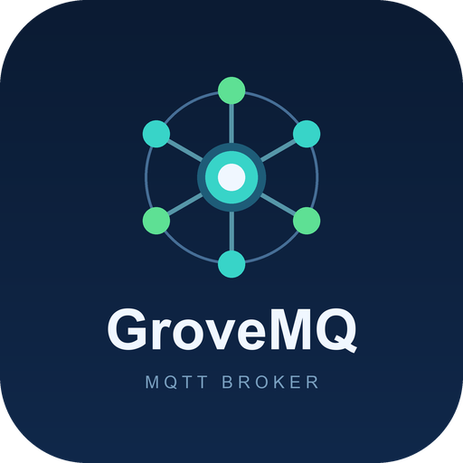

<p align="center">
  
</p>

<h1 align="center">GroveMQ</h1>

<p align="center">
  <strong>The MQTT broker built for unmatched scalability and reliability across AI, IoT, IIoT, and connected vehicles.</strong>
</p>

<p align="center">
  <a href="README.md">English</a> · <a href="README.zh-CN.md">简体中文</a>
</p>

<p align="center">
  <a href="https://github.com/RiemannChow/GroveMQ/actions"></a>
  <a href="https://github.com/RiemannChow/GroveMQ/blob/main/LICENSE"></a>
  <a href="https://golang.org/"></a>
  <a href="https://github.com/RiemannChow/GroveMQ/releases"></a>
  <a href="https://goreportcard.com/report/github.com/RiemannChow/GroveMQ"></a>
</p>

<p align="center">
  <a href="docs/README.md">Documentation</a> |
  <a href="docs/guides/CONFIG_GUIDE.md">Configuration</a> |
  <a href="docs/guides/DEPLOYMENT.md">Deployment</a> |
  <a href="LICENSE">License</a>
</p>

---

# GroveMQ

GroveMQ is an MQTT broker built for unmatched scalability and reliability across AI, IoT, IIoT, and connected vehicles. Written in Go, it combines a lightweight, actor-based core with durable sessions, retained messages, shared subscriptions, TLS and ACL-based security, Prometheus metrics, and a distributed cluster with gRPC routing and Kubernetes-native discovery.

## 🌟 Features

*   **Core MQTT v3.1.1 / v5.0 Broker**: Supports essential MQTT functionalities, including client connections (`CONNECT`), topic subscriptions (`SUBSCRIBE`), and message publishing (`PUBLISH`), with MQTT 5.0 properties and reason codes.
*   **Actor-Based Concurrency**: Leverages a lightweight, OTP-inspired actor model for robust and concurrent management of client sessions. Includes supervisors that follow the "let it crash" philosophy for fault tolerance.
*   **Dynamic Clustering**: Nodes can form a distributed cluster for high availability and load distribution. Message routing between nodes is handled automatically.
*   **Kubernetes-Native Discovery**: Automatically discovers peer nodes within a Kubernetes environment using a headless service, enabling seamless cluster formation.
*   **High-Performance Communication**: Utilizes gRPC for efficient and strongly-typed inter-node communication for routing, state synchronization, and cluster management.
*   **Prometheus Metrics**: Exposes key operational metrics (e.g., connection counts, actor restarts) in a Prometheus-compatible format for easy monitoring.

## Security note

[`config.yaml`](config.yaml) ships with **demo credentials** (for example `admin` / `admin123`) and authentication enabled so the broker is easy to try locally. These are **not** production credentials. Before exposing GroveMQ to any network, replace every password in `config.yaml`, disable the accounts you do not need, and review the TLS and ACL settings. The same demo credentials are used by the test suite, so keep them in sync if you change them.

## 🚀 Getting Started

### Prerequisites

*   Go (version 1.25 or later)
*   An MQTT client (e.g., [MQTTX](https://mqttx.app/) or `mosquitto-clients`)
*   Docker with the Compose v2 plugin (only for the Docker Compose cluster example)

### Building and Running

1.  **Clone the repository**:
    ```sh
    git clone https://github.com/RiemannChow/GroveMQ.git
    cd GroveMQ
    ```

2.  **Build the application**:
    ```sh
    go build ./cmd/grovemq
    ```
    This produces a `grovemq` binary in the repository root.

3.  **Run the broker** (from the repository root, so it can read [`config.yaml`](config.yaml)):
    ```sh
    ./grovemq
    ```
    The broker will start and listen for:
    *   MQTT connections on port `1883`.
    *   gRPC connections for clustering on port `8081`.
    *   Prometheus metrics on port `8082` at the `/metrics` endpoint.

### Connecting an MQTT Client

You can connect to the broker using any standard MQTT client.

*   **Host**: `localhost`
*   **Port**: `1883`

Once connected, you can subscribe to topics and publish messages to test the broker's functionality.

### Testing Cluster Functionality

GroveMQ supports distributed clustering for high availability and load distribution. You can test the cluster functionality locally:

**Quick Start - 3-Node Cluster**:

```sh
# Start a 3-node cluster (builds ./bin/grovemq and starts nodes on 1883/1884/1885)
./scripts/start-cluster.sh

# Run the cluster test
go run ./cmd/cluster-test

# Stop the cluster
./scripts/stop-cluster.sh
```

The test verifies cross-node message routing by:
1. Connecting a subscriber to Node2 (port 1884)
2. Connecting a publisher to Node1 (port 1883)
3. Publishing a message from Node1 and verifying it reaches Node2's subscriber

**Using Docker Compose**:

```sh
# Start the cluster with Docker Compose v2
docker compose -f docker-compose-cluster.yaml up -d

# Stop the cluster
docker compose -f docker-compose-cluster.yaml down
```

**Durable state**: set `GROVEMQ_DATA_DIR` to a writable directory to persist
sessions and retained messages and to enable cluster state replication. Each
node stores its data under `<GROVEMQ_DATA_DIR>/<NODE_ID>`. The local cluster
script, the Docker Compose file and the Kubernetes StatefulSet all set it by
default (`./data`, `/data` with a per-node volume). Without it, all state is
in-memory and is lost on restart.

```sh
# Single-node run with durable state
GROVEMQ_DATA_DIR=./data ./bin/grovemq
```

For detailed information about cluster testing, see:
- [Cluster Testing Guide](docs/testing/CLUSTER_TESTING_GUIDE.md) - How to deploy and test
- [E2E Test Report](docs/testing/CLUSTER_E2E_TEST_REPORT.md) - Detailed test results and bug fixes
- [Quick Summary](docs/testing/CLUSTER_TEST_SUMMARY.md) - Quick reference

## 🏗️ Project Structure

The repository is organized into the following main directories:

*   `cmd/grovemq`: The main application entrypoint, responsible for initializing and orchestrating all services.
*   `cmd/cluster-test`: Cluster testing tool for verifying cross-node message routing.
*   `pkg/`: Contains all the core packages of the broker.
    *   `actor`: A lightweight, OTP-inspired actor model for concurrency.
    *   `broker`: The central MQTT broker logic, responsible for handling connections and orchestrating message flow.
    *   `cluster`: Components for clustering, including the gRPC server/client and the cluster state manager.
    *   `discovery`: Service discovery, with a Kubernetes implementation for automatic peer finding.
    *   `metrics`: Defines and exposes Prometheus metrics for monitoring.
    *   `proto`: Contains the Protobuf definitions (`.proto` files) and generated Go code for gRPC-based cluster communication.
    *   `protocol/mqtt`: Low-level parsing and encoding of MQTT packets.
    *   `session`: An actor-based implementation for managing a single client session.
    *   `storage`: A generic key-value store interface with an in-memory implementation for session management.
    *   `supervisor`: An OTP-style supervisor for managing actor lifecycles and implementing fault tolerance.
    *   `topic`: A thread-safe store for managing topic subscriptions and routing.
*   `scripts/`: Utility scripts for cluster deployment, health checks, and testing.
*   `docs/`: Contains additional documentation on architecture and APIs.
*   `k8s/`: Kubernetes manifests for deploying the application.

## 📚 Documentation

**All documentation is organized in the [docs/](docs/) directory.**

### 📂 Quick Links

- **📖 [Documentation Index](docs/README.md)** - Complete documentation navigation
- **📖 [User Guides](docs/guides/)** - Deployment, configuration and troubleshooting
- **🧪 [Testing Guides](docs/testing/)** - Cluster, concurrency and E2E testing
- **🔥 [Chaos Engineering](docs/chaos/README.md)** - Chaos tooling, workflows and CLI
- **📊 [Reports](docs/reports/)** - Test reports and project status

### 🎯 For Different Roles

**New Users** → [Documentation Index](docs/README.md)

**Developers** → [Implementation Plan](docs/planning/PLAN.md) and [Module Map](docs/phase-0/mapping_table.md)

**Operators** → [Deployment Guide](docs/guides/DEPLOYMENT.md) and [Config Guide](docs/guides/CONFIG_GUIDE.md)

**Testers** → [Testing Documentation](docs/testing/) and [Chaos Engineering](docs/chaos/README.md)

### 📖 Code Documentation

The source code is documented using GoDoc conventions. The Go toolchain includes a built-in documentation viewer:

```sh
go doc ./...
go doc ./pkg/broker Broker
```

For a browsable local website, install the standalone `godoc` tool first (it is no longer bundled with Go), then start it:

```sh
go install golang.org/x/tools/cmd/godoc@latest
godoc -http=:6060
```

Open `http://localhost:6060/pkg/` and browse to the package you need.
