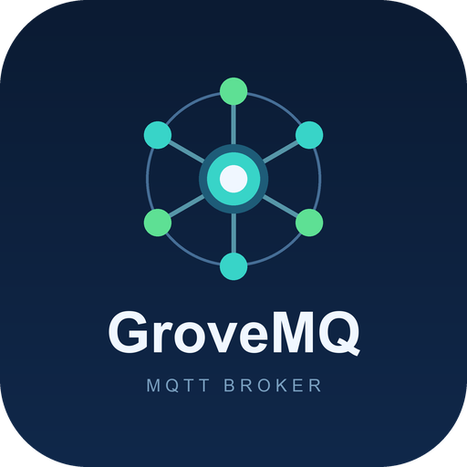

<p align="center">
  
</p>

<h1 align="center">GroveMQ</h1>

<p align="center">
  <strong>面向 AI、IoT、工业物联网与车联网场景打造，具备卓越扩展性与可靠性的 MQTT Broker。</strong>
</p>

<p align="center">
  <a href="README.md">English</a> · <a href="README.zh-CN.md">简体中文</a>
</p>

<p align="center">
  <a href="https://github.com/RiemannChow/GroveMQ/actions"></a>
  <a href="https://github.com/RiemannChow/GroveMQ/blob/main/LICENSE"></a>
  <a href="https://golang.org/"></a>
  <a href="https://github.com/RiemannChow/GroveMQ/releases"></a>
  <a href="https://goreportcard.com/report/github.com/RiemannChow/GroveMQ"></a>
</p>

<p align="center">
  <a href="docs/README.md">文档中心</a> |
  <a href="docs/guides/CONFIG_GUIDE.md">配置指南</a> |
  <a href="docs/guides/DEPLOYMENT.md">部署指南</a> |
  <a href="LICENSE">许可证</a>
</p>

---

# GroveMQ

GroveMQ 是一款面向 AI、IoT、工业物联网（IIoT）与车联网场景打造的 MQTT Broker，以卓越的扩展性与可靠性为核心目标。项目使用 Go 编写，将轻量级 Actor 内核与持久会话、保留消息、共享订阅、TLS 与 ACL 安全机制、Prometheus 指标，以及基于 gRPC 路由和 Kubernetes 原生服务发现的分布式集群能力结合在一起。

## 🌟 核心特性

*   **MQTT v3.1.1 / v5.0 协议内核**：支持客户端连接（`CONNECT`）、主题订阅（`SUBSCRIBE`）、消息发布（`PUBLISH`）等核心能力，并支持 MQTT 5.0 属性与原因码。
*   **基于 Actor 的并发模型**：采用轻量级、受 OTP 启发的 Actor 模型并发管理客户端会话；内置遵循 "let it crash" 理念的监督树，实现故障隔离与容错。
*   **动态集群**：多个节点可组成分布式集群，实现高可用与负载分担，节点间消息路由自动完成。
*   **Kubernetes 原生服务发现**：通过 Headless Service 自动发现 Kubernetes 环境中的对等节点，实现集群自动组建。
*   **高性能节点间通信**：使用 gRPC 完成路由、状态同步与集群管理，通信高效且类型安全。
*   **Prometheus 指标**：以 Prometheus 格式暴露连接数、Actor 重启次数等关键运维指标，便于监控告警。

## 安全提示

仓库中的 [`config.yaml`](config.yaml) 带有**演示用账号密码**（例如 `admin` / `admin123`）并默认开启认证，方便本地快速体验。这些**不能用于生产环境**。在将 GroveMQ 暴露到任何网络之前，请替换 `config.yaml` 中的全部密码、关闭不需要的账号，并仔细检查 TLS 与 ACL 配置。测试套件也使用同一套演示凭据，修改时请保持同步。

## 🚀 快速开始

### 环境要求

*   Go 1.25 或更高版本
*   MQTT 客户端（例如 [MQTTX](https://mqttx.app/) 或 `mosquitto-clients`）
*   已安装 Docker 及 Compose v2 插件（仅 Docker Compose 集群示例需要）

### 构建与运行

1.  **克隆仓库**：
    ```sh
    git clone https://github.com/RiemannChow/GroveMQ.git
    cd GroveMQ
    ```

2.  **构建应用**：
    ```sh
    go build ./cmd/grovemq
    ```
    构建完成后会在仓库根目录生成 `grovemq` 可执行文件。

3.  **启动 Broker**（请在仓库根目录执行，以便读取 [`config.yaml`](config.yaml)）：
    ```sh
    ./grovemq
    ```
    启动后将监听：
    *   MQTT 连接：`1883` 端口
    *   集群 gRPC 通信：`8081` 端口
    *   Prometheus 指标：`8082` 端口的 `/metrics` 路径

### 连接 MQTT 客户端

可以使用任意标准 MQTT 客户端连接：

*   **主机**：`localhost`
*   **端口**：`1883`

连接成功后即可订阅主题、发布消息，验证 Broker 功能。

### 验证集群功能

GroveMQ 支持分布式集群以实现高可用与负载分担，可在本地快速验证：

**快速启动 3 节点集群**：

```sh
# 启动 3 节点集群（构建 ./bin/grovemq，并在 1883/1884/1885 端口启动节点）
./scripts/start-cluster.sh

# 运行集群测试
go run ./cmd/cluster-test

# 停止集群
./scripts/stop-cluster.sh
```

该测试通过以下步骤验证跨节点消息路由：
1. 在 Node2（1884 端口）建立订阅者连接
2. 在 Node1（1883 端口）建立发布者连接
3. 从 Node1 发布消息，并确认消息送达 Node2 的订阅者

**使用 Docker Compose**：

```sh
# 使用 Docker Compose v2 启动集群
docker compose -f docker-compose-cluster.yaml up -d

# 停止集群
docker compose -f docker-compose-cluster.yaml down
```

**持久化状态**：设置 `GROVEMQ_DATA_DIR` 指向一个可写目录，即可持久化会话与保留消息，并启用集群状态复制。每个节点的数据存放在 `<GROVEMQ_DATA_DIR>/<NODE_ID>` 下。本地集群脚本、Docker Compose 文件与 Kubernetes StatefulSet 均已默认配置（分别为 `./data`、`/data` 并挂载每节点独立卷）。未设置时全部状态保存在内存中，重启即丢失。

```sh
# 单节点持久化运行
GROVEMQ_DATA_DIR=./data ./bin/grovemq
```

更多集群测试资料：
- [集群测试指南](docs/testing/CLUSTER_TESTING_GUIDE.md) —— 部署与测试步骤
- [E2E 测试报告](docs/testing/CLUSTER_E2E_TEST_REPORT.md) —— 详细结果与问题修复记录
- [测试摘要](docs/testing/CLUSTER_TEST_SUMMARY.md) —— 速查参考

## 🏗️ 项目结构

仓库主要目录说明：

*   `cmd/grovemq`：主程序入口，负责初始化与编排所有服务。
*   `cmd/cluster-test`：集群测试工具，用于验证跨节点消息路由。
*   `pkg/`：Broker 核心代码包。
    *   `actor`：轻量级、受 OTP 启发的 Actor 并发模型。
    *   `broker`：MQTT Broker 核心逻辑，负责连接处理与消息流转编排。
    *   `cluster`：集群组件，包含 gRPC 服务端/客户端与集群状态管理。
    *   `discovery`：服务发现，提供基于 Kubernetes 的自动对等节点发现实现。
    *   `metrics`：定义并暴露 Prometheus 监控指标。
    *   `proto`：Protobuf 定义（`.proto`）及 gRPC 生成的 Go 代码。
    *   `protocol/mqtt`：MQTT 报文的底层解析与编码。
    *   `session`：基于 Actor 的单客户端会话管理实现。
    *   `storage`：通用键值存储接口及用于会话管理的内存实现。
    *   `supervisor`：OTP 风格的监督器，管理 Actor 生命周期并实现容错。
    *   `topic`：线程安全的主题订阅与路由存储。
*   `scripts/`：集群部署、健康检查与测试相关的工具脚本。
*   `docs/`：架构与 API 等补充文档。
*   `k8s/`：用于部署应用的 Kubernetes 清单文件。

## 📚 文档

**全部文档统一存放在 [docs/](docs/) 目录。**

### 📂 常用入口

- **📖 [文档索引](docs/README.md)** —— 完整的文档导航
- **📖 [使用指南](docs/guides/)** —— 部署、配置与故障排查
- **🧪 [测试文档](docs/testing/)** —— 集群、并发与 E2E 测试
- **🔥 [混沌工程](docs/chaos/README.md)** —— 混沌工具、工作流与 CLI
- **📊 [项目报告](docs/reports/)** —— 测试报告与项目状态

### 🎯 按角色阅读

**新用户** → [文档索引](docs/README.md)（含快速开始指引）

**开发者** → [实施计划](docs/planning/PLAN.md) 与 [模块映射](docs/phase-0/mapping_table.md)

**运维人员** → [部署指南](docs/guides/DEPLOYMENT.md) 与 [配置指南](docs/guides/CONFIG_GUIDE.md)

**测试人员** → [测试文档](docs/testing/) 与 [混沌工程](docs/chaos/README.md)

### 📖 代码文档

源码按 GoDoc 规范编写了注释。Go 工具链自带文档查看命令：

```sh
go doc ./...
go doc ./pkg/broker Broker
```

如需在本地以网页形式浏览，请先安装独立的 `godoc` 工具（Go 已不再内置），再启动服务：

```sh
go install golang.org/x/tools/cmd/godoc@latest
godoc -http=:6060
```

然后打开 `http://localhost:6060/pkg/`，浏览所需的包即可。
