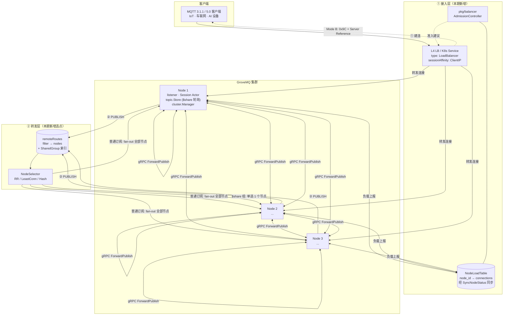
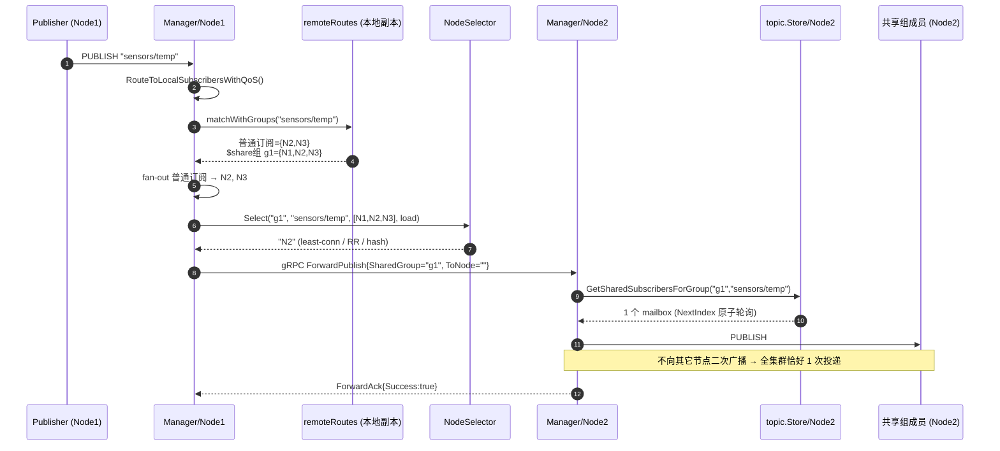
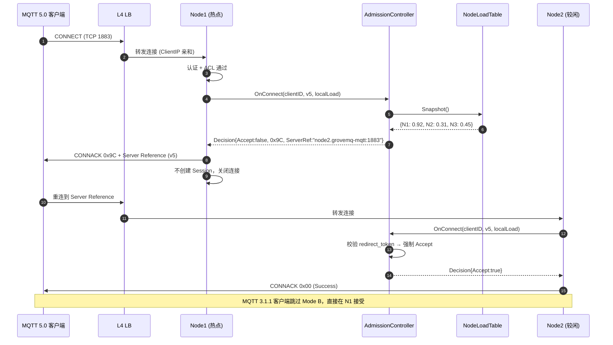

# GroveMQ 负载均衡能力设计（接入层 + 消息转发层）

| 项 | 值 |
| --- | --- |
| 状态 | **Draft — 待评审**，未实现、未提交 |
| 基线 | `52d0abf`（含 6 个 P0 修复） |
| 范围 | 连接接入层负载均衡、消息转发层负载均衡 |
| 作者 | GroveMQ Team |
| 关联 | `docs/phase-3/RISK.md`（topic 分片设想）、`docs/guides/DEPLOYMENT.md`（K8s 示例） |

> 本文只做设计，**不改代码**。评审通过后按第 11 节拆分实现，每个改动一个英文 commit。
> 文中所有"现状"结论均来自对基线代码的实读，行号以基线为准。

---

## 1. 背景与现状核查

README（`README.md:40`、`:91`）宣称集群提供 *"load distribution"*。实读代码后，两层能力都不成立：

| 层 | 期望 | 基线实际 | 依据 |
| --- | --- | --- | --- |
| 接入层 · 连接分发 | 新连接按负载分摊到多节点 | 每节点仅一个 MQTT TCP listener，无节点选择/权重/哈希；`k8s/` 只有 `headless-service.yaml`（`clusterIP: None`，服务发现用，不做 LB） | `cmd/grovemq/main.go:277`、`k8s/headless-service.yaml:16` |
| 接入层 · L4 LB 清单 | 仓库自带可部署的 LB Service | 只有 `docs/guides/DEPLOYMENT.md:316` 的 `type: LoadBalancer` 示例，未进 `k8s/` | — |
| 接入层 · MQTT 5 重定向 | CONNACK `Server Reference` / `0x9C` 引流 | 全仓库无实现 | grep `ServerReference` / `0x9C` 无命中 |
| 转发层 · 节点间选点 | 从匹配节点里挑一个 / 按权重 | `RouteRemote` 对 `MatchRemoteSubscribers` 结果**逐个** `forwardToNode` → fan-out 广播，不是负载均衡 | `pkg/cluster/manager.go:339` |
| 转发层 · 订阅者间 | 共享组内挑一个 | 单节点内 `$share/<g>/<t>` 的 `NextIndex` 原子轮询，是**唯一**真正的均衡（P0-3 修过 race） | `pkg/topic/store.go:226`（原子游标在 `:238`） |
| **跨节点共享订阅** | 全集群一个组只投递一次 | **不通**：SUBSCRIBE 把原始 `$share/g/t` 原样注册为路由 filter，而 `routeTopicMatches("t", "$share/g/t")` 因层级数 1≠3 直接返回 false，其它节点永不转发过来 | `pkg/broker/broker.go:1524` → `pkg/cluster/manager.go:371` |
| 负载数据 | 有实时节点负载可做决策 | `pkg/clustermon` 的 `LoadBalanceRatio` / `ConnectionsPerNode` 是**死代码**：`NewClusterMonitor` 在 `pkg/clustermon` 之外零调用，且 `collectMetrics()` 只填本地节点 | `pkg/clustermon/cluster.go:260` |

补充事实（影响方案选型）：

- `pkg/proto/cluster/cluster.proto` 是生成源（`cluster.pb.go` 头部：`source: pkg/proto/cluster/cluster.proto`）；仓库里还有一份 **schema 不同、更旧**的 `proto/cluster/cluster.proto`，只改它会静默失效。
- mochi-mqtt 已支持 `Properties.ServerReference`（`PropServerReference = 28`，对 `Connack` / `Disconnect` 合法），**不需要自己写 wire 编码**。
- `connackReturnCode(pv, v5)`（`pkg/broker/broker.go:959`）对未知 v5 码在 3.1.1 上一律折叠为 `0x05`；`0x9C` 在 3.1.1 没有等价物。
- 本地实时连接数有现成来源：`metrics.ConnectionsGauge`（`grovemq_connections_count`）与 `Broker.connections` map；`BrokerConfig.MaxConnections` 已存在，可做准入上限。
- `ForwardPublish` 的 handler 调用 `LocalPublishFunc` → `RouteToLocalSubscribersWithQoS` → `GetSubscribers()`，其中共享订阅**已经**在目标节点内做一次轮询。因此"发布节点为共享组只选一个节点"能自然得到"全集群恰好一次投递"，无需改动投递端语义。
- `PublishForward` 当前不携带 `MessageId` / `Retain` / `Dup` / `UserProperties`，跨节点是 at-most-once；`ApplyStateEntries` 只做 union 合并，UNSUBSCRIBE 后陈旧路由会残留。这两点是既有缺陷，本设计**不扩大、也不顺手修**，在第 10 节登记为独立工单。
- `NODE_ADVERTISE_ADDR`（P0-5 新增）是 **gRPC 地址**，不能用作 MQTT 5 `Server Reference`（客户端需要的是 MQTT 端点）。

### 1.1 结论

> 接入层 = 0（完全依赖外部 LB，仓库未交付）；
> 转发层 = 0.5（广播 + 单节点内共享订阅轮询，跨节点共享订阅实际损坏）。
> 因此本设计把「修跨节点 `$share`」定位为 **P0 bug 修复**，其余为能力增强。

---

## 2. 术语与范围

| 术语 | 含义 |
| --- | --- |
| 接入层 LB | 决定**一条客户端 TCP/WebSocket 连接落在哪个节点**。MQTT 是长连接，均衡只发生在建连瞬间。 |
| 转发层 LB | 决定**一条已发布的消息走哪些远端节点**。注意与普通订阅的 fan-out 语义冲突，必须按订阅类型区分。 |
| 普通订阅 | 非 `$share` 订阅。MQTT 语义要求所有匹配订阅者都收到 → **必须 fan-out，不能均衡**。 |
| 共享订阅 | `$share/<group>/<topic>`。MQTT 5 语义要求同组恰好一个成员收到 → **必须单选**。 |
| `SharedGroup` | 从 filter 中解析出的 `<group>` 标识，是全局选点的键。 |
| NodeLoad | 节点的轻量负载快照（连接数、会话数、订阅数、时间戳）。 |

**非目标（本期不做）**

- topic 分片 / 一致性哈希分区（`docs/phase-3/RISK.md:51`），独立立项。
- 跨节点 QoS 1/2 端到端可靠转发（现有 `PublishForward` 语义缺陷）。
- 已有连接的在线迁移（MQTT 无标准迁移动作，只能靠重连）。
- 自动扩缩容（HPA / Cluster Autoscaler 策略）。

---

## 3. 目标与验收标准

| # | 目标 | 验收标准 |
| --- | --- | --- |
| G1 | 跨节点 `$share` 组正确投递 | 3 节点各 1 个同组成员，发布 100 条 → 全集群恰好 100 次投递，无重复、无丢失 |
| G2 | 普通订阅语义不变 | 3 节点各有 1 个普通订阅者，发布 1 条 → 3 次投递 |
| G3 | 转发层选点策略可插拔 | round-robin / least-connections / consistent-hash 三种实现，通过配置切换，单测覆盖 |
| G4 | 接入层有可部署方案 | `k8s/service.yaml` 可直接 `kubectl apply`；MQTT 5 重定向可用 `0x9C` + `Server Reference` 验证 |
| G5 | 灰度安全 | 新行为默认关闭，滚动升级中新旧节点混跑不产生错误投递 |
| G6 | 文档收敛 | README / 中文 README 的 "load distribution" 改为与实现一致的表述 |

---

## 4. 总体架构

### 4.1 目标架构（Mermaid）



### 4.2 分层职责

| 层 | 决策对象 | 决策频率 | 数据来源 | 失败降级 |
| --- | --- | --- | --- | --- |
| 接入层 | 一条 CONNNECT | 每次建连（低频） | `NodeLoadTable` | L4 LB 单选 / 本地接受 |
| 转发层 | 一条 PUBLISH | 每消息（高频，热点路径） | 本地路由表 + `NodeLoadTable` 快照 | 退回 fan-out（保持现状语义，宁可重复不可丢失） |

> **性能约束**：转发层在 `routePublish` 热路径上，选点必须是 O(匹配节点数) 的纯内存操作，禁止 RPC 同步调用、禁止持锁做网络 I/O。

配图：[目标架构 PNG](images/lb-architecture.png) · [SVG](images/lb-architecture.svg)

---

## 5. 转发层详细设计

### 5.1 根因

```
SUBSCRIBE "$share/g/sensors/#"
   └─ broker.go:1505  b.topics.Subscribe(sub.Filter, ...)          ← 本地正确：topic.Store 拆出 group + 真实 topic
   └─ broker.go:1524  newRoute.Topic = sub.Filter                  ← 传的是原始 "$share/g/sensors/#"
   └─ broker.go:1539  cluster.RegisterRoute("$share/g/sensors/#")
   └─ manager.go      remoteRoutes["$share/g/sensors/#"] = {node1}
PUBLISH "sensors/temp"
   └─ manager.go:339  MatchRemoteSubscribers("sensors/temp")
   └─ manager.go:348  routeTopicMatches("sensors/temp", "$share/g/sensors/#")
                       tLevels=2, fLevels=3 → 长度不等 → false       ← 路由永远不命中
```

同时 `RouteRemote` 无差别 fan-out：即使 filter 修好，一个跨 3 节点的共享组会收到 3 份转发、每节点各选 1 个成员 → **3 次投递**，违反 MQTT 5 共享订阅语义。

### 5.2 数据模型变更

#### 5.2.1 路由表增加共享组维度

`pkg/cluster/manager.go` 现有：

```go
remoteRoutes map[string]map[string]struct{} // filter → nodeIDs
```

改为（保持只读路径零分配）：

```go
// RouteKey 是路由表的复合键。普通订阅 group 为空；共享订阅 group 为
// 从 $share/<group>/<topic> 解析出的组名，filter 为剥离前缀后的真实 topic filter。
type RouteKey struct {
    Group  string
    Filter string
}

remoteRoutes map[RouteKey]map[string]struct{}
sharedGroups map[string]map[RouteKey]struct{} // group → 该组涉及的路由键，便于整组失效
```

`RegisterRoute` / `UnregisterRoute` 增加 `group string` 参数（或新增 `RegisterSharedRoute`），由 broker 在 SUBSCRIBE 时调用 `ParseSharedFilter()`：

```go
// ParseSharedFilter 把 "$share/g/sensors/#" 拆成 ("g", "sensors/#")。
// 非共享订阅返回 ("", 原 filter)。非法形式（段数 < 3、空 group）返回 error，
// SUBACK 以 0x9F (Topic Filter invalid) 拒绝。
func ParseSharedFilter(filter string) (group, topic string, err error)
```

> **兼容点**：`replicateRoutes()` 目前把整张表 gob 编码进 `ReplicateState("routes", "routes:global", ...)`。表结构一变，滚动升级时新旧节点互相解码会失败。做法：state key 升版本为 `routes:v2`，`ApplyStateEntries` 同时识别 `routes`（旧格式，转成 v2 只读）与 `routes:v2`；新节点默认仍写 v1，直到配置开启 `shared_route_policy=single` 才写 v2。

#### 5.2.2 proto 变更（`pkg/proto/cluster/cluster.proto`）

```proto
message PublishForward {
  // ... 现有 1..11 保持不变 ...
  // shared_group 非空表示这是一次共享订阅组的单选转发：接收节点必须
  // 把消息交给该组（而非所有匹配订阅者），且不得再次向其它节点广播。
  string shared_group = 12;
  // selector_epoch 是发布节点做决策时看到的路由表版本，用于诊断
  // 成员变更期间的重复/漏投，不参与投递决策。
  uint64 selector_epoch = 13;
}

message Route {
  string topic = 1;
  repeated string node_ids = 2;
  int64 update_time = 3;
  string shared_group = 4;   // 新增，空 = 普通订阅
}

message SyncNodeStatusResponse {
  bool success = 1;
  string message = 2;
  repeated NodeInfo all_nodes = 3;
  NodeLoad load = 4;          // 新增：响应方顺带回报自身负载
}

message NodeLoad {
  string node_id = 1;
  int64 connections = 2;
  int64 sessions = 3;
  int64 subscriptions = 4;
  int64 max_connections = 5;
  int64 unix_nano = 6;
}
```

**注意**：`proto/cluster/cluster.proto` 是残留旧副本，schema 与生成源不一致。实现时要么同步更新、要么（建议）在独立 commit 里删除并在 README 说明，避免后人改错文件。

### 5.3 负载数据通道

`clustermon` 是死代码，**不复用**。新增 `pkg/cluster/load.go`：

```go
// NodeLoadTable 保存各节点最近一次负载快照，只读快照供选点使用。
// 写入：SyncNodeStatus 响应（每 5s 随心跳捎带，无新增 RPC）。
// 读取：RouteRemote / AdmissionController 获取 Snapshot()（返回不可变副本）。
type NodeLoadTable struct {
    mu      sync.RWMutex
    entries map[string]NodeLoad
}

func (t *NodeLoadTable) Update(l NodeLoad)
func (t *NodeLoadTable) Snapshot() map[string]NodeLoad
func (t *NodeLoadTable) IsStale(nodeID string, maxAge time.Duration) bool
```

- 本节点负载由 `metrics.ConnectionsGauge` + `Broker.connections` 实时读取，无需等心跳。
- 远端负载通过既有 `SyncNodeStatus` liveness probe（`pkg/cluster/server.go:139`，当前只回 `AllNodes`）捎带返回，改动最小、不新增 RPC。
- 超过 `2 * heartbeat`（默认 10s）未更新的节点视为 `stale`，选点时降权或跳过（见 5.5 降级）。

> 备选（评审决定）：新增 `ReportLoad` 流式 RPC。优点是负载更实时、可带权重；缺点是增加连接与失败面。本设计推荐先做 `SyncNodeStatus` 捎带。

### 5.4 选点策略接口

```go
// pkg/cluster/selector.go
type Selection struct {
    Nodes        []string // 需要 fan-out 的普通订阅目标节点
    SharedTarget string   // 共享组唯一目标节点，空 = 无成员
}

type NodeSelector interface {
    // Select 从候选节点里挑一个；candidates 已去重、已剔除自身与不可达节点。
    Select(group, topic string, candidates []string, load NodeLoadSnapshot) (string, error)
    Name() string
}
```

三种实现：

| 策略 | 算法 | 适用场景 | 状态 |
| --- | --- | --- | --- |
| `RoundRobinSelector` | `atomic.Uint64` 按 `group` 分桶自增取模（与 `topic.Store.NextIndex` 同样的原子游标写法） | 默认、无负载数据时 | 无外部依赖 |
| `LeastConnectionsSelector` | `argmin(load.connections / max_connections)`，同分按 nodeID 字典序打破平局 | 长连接负载不均 | 依赖 `NodeLoadTable` |
| `ConsistentHashSelector` | `hash(group + "/" + topic) % N`（有界负载一致性哈希） | 需要组级粘性、减少抖动 | 无状态 |

**关键约束**

- `Select` 必须是纯函数式（不持 `Manager.mu` 做网络 I/O、不阻塞）；`MatchRemoteSubscribers` 已经在 `mu.RLock` 下返回拷贝，选点在其后执行。
- 组级粘性：同一个 `group` 在成员集合不变时应持续选到同一节点，避免每次 PUBLISH 抖动导致会话/QoS 状态漂移。RoundRobin 的"按 group 分桶"而不是全局游标，正是为此。
- 平局必须确定性（字典序），否则多节点各自决策会产生不一致。

### 5.5 PUBLISH 路径改造

`pkg/broker/broker.go:2413` `routePublish` 与 `pkg/cluster/manager.go:339` `RouteRemote`：

```go
// RouteRemote 按订阅类型分流：
//  - 普通订阅（group == ""）：保持 fan-out，语义不变；
//  - 共享订阅（group != ""）：整组只选一个目标节点，携带 SharedGroup 转发。
func (m *Manager) RouteRemote(topic string, payload []byte, qos byte) {
    sel := m.matchWithGroups(topic)          // → map[group][]string + 普通订阅节点集合
    m.forwardToNodes(topic, payload, qos, sel.Nodes, "" /* group */)
    for group, candidates := range sel.Groups {
        target, err := m.selector.Select(group, topic, candidates, m.loads.Snapshot())
        if err != nil || target == "" {      // 无成员 / 全部 stale
            continue                          // 降级见下
        }
        m.forwardToNodeShared(topic, payload, qos, target, group)
    }
}
```

`ForwardPublish` handler（`pkg/cluster/server.go:102`）改造：

```go
if req.SharedGroup != "" {
    // 目标节点：只交给该共享组，由本地 topic.Store 的 round-robin 选 1 个成员。
    s.manager.LocalSharedPublishFunc(req.Topic, req.Payload, byte(req.Qos), req.SharedGroup)
    return &clusterpb.ForwardAck{Success: true}, nil
}
// 普通订阅：保持现有 LocalPublishFunc + ToNode 中继逻辑不变。
```

`LocalSharedPublishFunc` 是 `Broker` 新增回调，内部走 `b.topics.GetSharedSubscribersForGroup(group, topic)`（新增 API，复用现有 `SharedSubscription.NextIndex` 原子游标），**避免** `GetSubscribers()` 把普通订阅者也带上。

**降级规则（宁可重复，不可丢失）**

| 情况 | 行为 |
| --- | --- |
| `shared_route_policy=fanout`（默认） | 完全走旧路径，行为与基线一致 |
| 候选节点全为 `stale` | 退回 fan-out 到所有候选，并打点 `lb_stale_fallback_total` |
| 选中的节点不可达 / `ForwardPublish` 失败 | 重选一次（跳过失败节点）→ 仍失败则 fan-out 兜底 |
| `ToNode` 中继链（Replicant 无直连） | 复用现有 `forwardToNodeFrom(..., exclude=FromNode)`，选点结果作为 `ToNode` 透传 |

### 5.6 时序（Mermaid）



配图：[转发时序 PNG](images/lb-sequence.png) · [SVG](images/lb-sequence.svg)

### 5.7 边界与一致性

| 场景 | 处理 |
| --- | --- |
| 组成员在 3 个节点上下线 | 路由表带 `epoch`；成员变更时递增。选点只读快照，最多一个窗口内不一致，靠 5.5 的 fan-out 兜底避免丢失 |
| 同一 group 不同 topic filter（`$share/g/a/#` 与 `$share/g/b/#`） | 选点键用 `group` 而非 filter，保证同组消息落到同一节点 |
| 同一消息同时命中普通订阅和共享订阅 | 两条路径并行，普通 fan-out + 共享单选，互不干扰 |
| 目标节点 Replicant 无直连 peer | `ToNode` 中继经 Core，保持现有逻辑 |
| QoS / retained | 沿用现有 `PublishForward` 语义，本设计不引入新的可靠性承诺；单独工单 |
| `UNSUBSCRIBE` 后陈旧路由 | 既有 union-only 合并缺陷，本设计的 `UnregisterRoute(group, ...)` 会把删除意图编码进 v2 state entry，顺带缓解但不彻底修复 |
| 热路径内存 | `matchWithGroups` 复用现有 `seen` map 去重，避免每消息分配；`Snapshot()` 返回只读副本，选点不再分配 |

---

## 6. 接入层详细设计

两种模式可独立启用，也可叠加（Mode A 为主、Mode B 为增强）。

### 6.1 Mode A — L4 负载均衡（推荐先落地）

新增 `k8s/service.yaml`（仓库此前缺失）：

```yaml
apiVersion: v1
kind: Service
metadata:
  name: grovemq-mqtt
  namespace: grovemq
  labels: { app: grovemq }
spec:
  type: LoadBalancer
  # MQTT 是长连接：均衡只发生在建连瞬间。ClientIP 亲和保证重连尽量
  # 落回原节点，减少会话迁移与 retained/will 状态漂移。
  sessionAffinity: ClientIP
  sessionAffinityConfig:
    clientIP:
      timeoutSeconds: 10800
  externalTrafficPolicy: Local   # 保留源 IP，配合 ClientIP 亲和
  selector: { app: grovemq }
  ports:
    - { name: mqtt,      port: 1883, targetPort: 1883, protocol: TCP }
    - { name: websocket, port: 8083, targetPort: 8083, protocol: TCP } # 若启用 WS
    - { name: tls-mqtt,  port: 8883, targetPort: 8883, protocol: TCP } # 若启用 TLS
```

要点与限制：

- **不要用 HTTP/Ingress 做 MQTT**：L7 代理会破坏 MQTT 帧与长连接；只走 L4（云 LB / MetalLB / HAProxy TCP mode / Envoy TCP proxy）。
- `externalTrafficPolicy: Local` 保留源 IP，但会丢弃没有本地端点的节点的流量；StatefulSet 每 Pod 都有端点，可接受。
- 长连接下"连接数均衡"只在建连时生效，运行期热点靠 `MaxConnections` 上限 + Mode B 的重定向少量修正，**不做在线迁移**。
- `docs/guides/DEPLOYMENT.md:316` 的示例改为指向该清单，避免两处漂移。

### 6.2 Mode B — MQTT 5.0 Server Reference 重定向

新增 `pkg/balancer/admission.go`：

```go
type Decision struct {
    Accept      bool   // false = 拒绝本次连接并引导重连
    ReasonCode  byte   // MQTT5: 0x9C Use another server；MQTT3.1.1: 见下
    ServerRef   string // 客户端可达的 MQTT 端点，如 "node2.grovemq-mqtt:1883"
}

type AdmissionController interface {
    OnConnect(clientID string, protoVer byte, local NodeLoad) Decision
}
```

**决策流程**

1. 客户端 CONNECT 到达 Node1，认证/ACL 通过之后、创建 Session 之前调用 `OnConnect`。
2. 从 `NodeLoadTable.Snapshot()` 取各节点 `connections / max_connections`（含自身实时值）。
3. 若自身利用率 ≤ `soft_limit`（默认 0.8）或没有更优节点 → `Accept=true`，正常走 CONNACK 成功路径。
4. 否则选出负载最低节点 N2，`Accept=false`：
   - MQTT 5.0：`ReasonCode = 0x9C (Use another server)`，`resp.Properties.ServerReference = N2 的 MQTT_ADVERTISE_ADDR`，`resp.ProtocolVersion = 5`。mochi 的 `ConnackEncode` 会自动编码该属性（`PropServerReference = 28` 对 Connack 合法）。
   - MQTT 3.1.1：**不存在 0x9C**。不做重定向，直接本地接受（避免 `connackReturnCode` 折叠成 `0x05` 把客户端搞坏）。行为退化为 Mode A。
5. 客户端按 `Server Reference` 重连到 N2。

**防环路**

- 每次 CONNECT 只允许 1 跳重定向；`AdmissionController` 在 `ServerRef` 里附带一次性 `redirect_token`（HMAC(nodeID + timestamp + clientID)），N2 校验通过则强制 `Accept=true`，不再重定向。
- 加 `redirect_cooldown`（默认 30s）与每 clientID 计数，防止不遵守规范的客户端在节点间弹跳。
- 负载数据 `stale` 时禁用重定向（宁可局部热点，不可把连接引到已下线节点）。

**新增配置 / 环境变量**

| 名称 | 默认 | 说明 |
| --- | --- | --- |
| `GROVEMQ_ACCESS_LB` | `off` | `off` / `l4` / `redirect` / `both` |
| `MQTT_ADVERTISE_ADDR` | 空 | 客户端可达的 MQTT 端点。**与 `NODE_ADVERTISE_ADDR`（gRPC）不同**，K8s 用 `$(NODE_ID).grovemq-mqtt:1883` |
| `GROVEMQ_LB_SOFT_LIMIT` | `0.8` | 触发重定向的自身利用率阈值 |
| `GROVEMQ_LB_STRATEGY` | `round_robin` | 转发层 `NodeSelector` 策略 |
| `GROVEMQ_SHARED_ROUTE_POLICY` | `fanout` | `fanout`（兼容基线）/ `single`（新语义） |

`BrokerConfig` 增加 `Balance BalanceConfig` 段（`config.yaml` / `DefaultConfig()` 同步，遵循 P0-1 里"两个配置源保持一致"的约束）。

### 6.3 时序（Mermaid）



### 6.4 边界

| 场景 | 处理 |
| --- | --- |
| 客户端忽略 `Server Reference` | 反复重连到 N1 会被 `redirect_cooldown` 放行（本地接受），不无限拒绝 |
| TLS / SNI | `ServerRef` 必须是客户端证书可校验的主机名；与 `MQTT_ADVERTISE_ADDR` 一起配置，文档说明 |
| WebSocket 接入 | 同样走 Mode A；Mode B 的 `ServerRef` 需带 `ws(s)://` 前缀（单独字段或 URI），本期可先不支持 WS 重定向 |
| 已有连接 | 不迁移。节点扩容后的存量热点只能等客户端重连 |
| 认证顺序 | 重定向判定放在**认证之后**，避免把无效凭据也引到别的节点（放大攻击面） |
| 滚动升级 | `GROVEMQ_ACCESS_LB=off` 为默认，老节点不受影响 |

---

## 7. 变更清单汇总

| 文件 | 变更 | 类型 |
| --- | --- | --- |
| `pkg/proto/cluster/cluster.proto` | `PublishForward.shared_group/selector_epoch`、`Route.shared_group`、`SyncNodeStatusResponse.load`、新增 `NodeLoad` | 协议 |
| `pkg/proto/cluster/*.pb.go` | 重新生成（`protoc v4.25.1` / `protoc-gen-go v1.36.9`） | 生成物 |
| `proto/cluster/cluster.proto` | 同步 or 删除（独立 commit 处理残留副本） | 清理 |
| `pkg/cluster/manager.go` | `RouteKey` 复合键、`matchWithGroups`、`RouteRemote` 分流、`UnregisterRoute` 支持删除意图、`routes:v2` state entry | 核心 |
| `pkg/cluster/selector.go` | 新增 `NodeSelector` + 3 种实现 | 新增 |
| `pkg/cluster/load.go` | 新增 `NodeLoadTable` | 新增 |
| `pkg/cluster/server.go` | `SyncNodeStatus` 回报 `NodeLoad`；`ForwardPublish` 支持 `SharedGroup` | 核心 |
| `pkg/broker/broker.go` | `ParseSharedFilter`、SUBSCRIBE 注册带 group、CONNACK `0x9C` + `ServerReference`、`LocalSharedPublishFunc` | 核心 |
| `pkg/broker/admission.go` / `pkg/balancer/*` | 新增接入层准入控制 | 新增 |
| `pkg/topic/store.go` | 新增 `GetSharedSubscribersForGroup(group, topic)`（复用原子游标） | API |
| `pkg/config/config.go` | `BalanceConfig`、`MQTTAdvertiseAddr` | 配置 |
| `cmd/grovemq/main.go` | 装配 `NodeLoadTable` / `NodeSelector` / `AdmissionController`、`MQTT_ADVERTISE_ADDR` | 装配 |
| `k8s/service.yaml` | 新增 L4 LB Service | 部署 |
| `k8s/statefulset.yaml` | `MQTT_ADVERTISE_ADDR` via Downward API | 部署 |
| `docs/guides/DEPLOYMENT.md`、`README.md`、`README.zh-CN.md` | 文档收敛 + 新配置说明 | 文档 |

---

## 8. 测试计划

| 层 | 用例 | 位置 |
| --- | --- | --- |
| 单元 | `ParseSharedFilter` 合法/非法形式（`$share/g/t`、`$share//t`、`$share/g`、普通 filter） | `pkg/broker/broker_test.go` |
| 单元 | `NodeSelector` 三策略：确定性、平局打破、空候选、组级粘性 | `pkg/cluster/selector_test.go` |
| 单元 | `NodeLoadTable` 并发读写 / stale 判定（`-race`） | `pkg/cluster/load_test.go` |
| 单元 | CONNACK `0x9C` + `Server Reference` 的 v5 字节编码；v3.1.1 不重定向 | `pkg/broker/broker_test.go` |
| 单元 | 共享组路由注册后 `routeTopicMatches("t", "t")` 命中、`UnregisterRoute` 删除 | `pkg/cluster/manager_test.go` |
| 集成 | **3 节点、同组 3 成员、发布 100 条 → 恰好 100 次投递**（G1 主验收） | `tests/integration/shared_lb_test.go` |
| 集成 | 3 节点普通订阅 → 3 次投递（G2 回归） | 同上 |
| 集成 | 成员上下线、目标节点宕机、Replicant 经 Core 中继 | 同上 |
| 集成 | 新旧节点混跑（`fanout` vs `single` 策略）、`routes` / `routes:v2` 双向解码 | `tests/integration/` |
| 契约 | 现有 `tests/contract` + `tests/unit` 全绿（匿名配置不变） | CI Contract Test job |
| 竞态 | `go test -race ./pkg/... ./cmd/...`（CI Test job） | CI |
| E2E | mosquitto / HiveMQ MQTT5 客户端对 `0x9C` + Server Reference 的实际行为 | `tests/e2e/` |
| 混沌 | 发布中杀目标节点、网络分区、负载数据全 stale | `tests/chaos/` |

> 本地已知 flaky：`pkg/persistent` 的 `TestWillMessageManager_ConcurrentOperations` 用固定 100ms 等延迟定时器，`-race` 下偶发 0/25。与本设计无关，登记为独立工单。

---

## 9. 可观测性

新增 Prometheus 指标（沿用 `pkg/metrics` 的 `promauto` 风格）：

| 指标 | 类型 | 标签 | 用途 |
| --- | --- | --- | --- |
| `grovemq_lb_selected_node_total` | Counter | `strategy, group, node` | 选点分布是否倾斜 |
| `grovemq_lb_redirect_total` | Counter | `reason, from, to` | 接入层重定向次数 |
| `grovemq_lb_stale_fallback_total` | Counter | `policy` | 负载数据过期触发的 fan-out 兜底 |
| `grovemq_shared_route_targets` | Gauge | `group` | 当前共享组候选节点数 |
| `grovemq_node_load` | Gauge | `node_id` | 各节点连接数快照 |
| `grovemq_lb_decision_duration_seconds` | Histogram | `layer` | 热路径耗时（转发层要求 P99 < 100µs） |

Dashboard / `clustermon` 若后续接线，可直接消费这些指标；本期不强制激活 `clustermon`。

---

## 10. 风险与缓解

| # | 风险 | 影响 | 缓解 |
| --- | --- | --- | --- |
| R1 | 滚动升级中新旧节点路由表格式不同 | 路由丢失 / 解码失败 | `routes:v2` 双读、新行为默认关闭、灰度开关 |
| R2 | 共享组选点在成员变更窗口内重复或漏投 | 违反 MQTT 语义 | `epoch` 诊断 + 失败 fan-out 兜底（宁可重复不可丢失） |
| R3 | `Server Reference` 客户端支持度参差（部分 MQTT5 客户端忽略） | 重定向无效、连接堆积热点 | Mode A 为主路径；`redirect_cooldown` 放行；文档标注已验证客户端 |
| R4 | 长连接下 least-connections 失真（连接数不等于消息量） | 热点 | 组合 `MaxConnections` 上限、慢启动、后续引入消息速率维度 |
| R5 | 转发层选点进入 PUBLISH 热路径 | 吞吐下降 | 纯内存 O(N)、无锁读快照、禁 RPC；P99 指标看护 |
| R6 | `proto/cluster/cluster.proto` 残留副本被误改 | 协议变更静默失效 | 独立 commit 删除/对齐 + pb.go header 校验加入 CI |
| R7 | 跨节点 at-most-once（`PublishForward` 缺字段） | 均衡后丢消息更明显 | **不在本期修**，独立工单；本期不引入新的可靠性承诺 |
| R8 | `ApplyStateEntries` union-only 合并 | UNSUBSCRIBE 后陈旧路由 | 独立工单；v2 state entry 携带删除意图做部分缓解 |
| R9 | 重定向环路 / 放大攻击 | 连接风暴 | 单跳 + HMAC token + cooldown + 认证后再判定 |
| R10 | `MQTT_ADVERTISE_ADDR` 配错（写成 gRPC 地址） | 客户端连不上 | 启动日志打印解析后的 MQTT 端点；配置校验拒绝包含 gRPC 端口 |

---

## 11. 实施拆分与排期（评审通过后执行）

按依赖顺序，**每个 commit 一个英文 log**，与 P0 批次同样的验证流程（`go vet` + 逐包 `-race` + CI）。

| # | Commit（英文） | 内容 | 估时 |
| --- | --- | --- | --- |
| 1 | `fix(cluster): register shared-subscription routes with their group and real topic filter` | `ParseSharedFilter` + 路由注册修复（G1 的 bug 部分，可独立提前发布） | 0.5d |
| 2 | `feat(cluster): add node load table and report load via SyncNodeStatus` | `NodeLoadTable` + proto `NodeLoad` + 心跳捎带 | 0.5d |
| 3 | `feat(cluster): introduce pluggable node selector strategies` | `NodeSelector` + RR/LeastConn/Hash + 单测 | 0.5d |
| 4 | `feat(cluster): select one target node for cross-node shared subscription groups` | `RouteRemote` 分流 + `SharedGroup` 转发 + `LocalSharedPublishFunc` + 集成测试（G1/G2） | 1d |
| 5 | `feat(deploy): add L4 load balancer Service for MQTT connections` | `k8s/service.yaml` + 文档 + `MQTT_ADVERTISE_ADDR` | 0.5d |
| 6 | `feat(broker): redirect overloaded MQTT 5 connections with Server Reference` | `AdmissionController` + `0x9C` CONNACK + 防环 + E2E | 1d |
| 7 | `chore(config): wire load-balancing flags into config and defaults` | `BalanceConfig`、灰度开关、两配置源一致性测试 | 0.5d |
| 8 | `docs: align load distribution claims with the implemented behavior` | README / 中文 README / DEPLOYMENT 收敛 | 0.25d |

合计约 **4.75 人日**。若只做转发层（#1–#4），约 2.5 人日即可拿到最大收益（修掉跨节点 `$share` 损坏 + 可插拔选点）。

---

## 12. 待评审决策（Open Questions）

1. **#1 是否单独先发？** 它是 bug 修复而非增强，可独立于整套 LB 设计先合入并回补测试；其余等评审。
2. **负载通道**：复用 `SyncNodeStatus` 捎带（改动小、5s 粒度）vs 新增 `ReportLoad` RPC（更实时）？
3. **残留 proto 副本**：`proto/cluster/cluster.proto` 直接删除，还是同步维护？（建议删除）
4. **默认策略切换版本**：`GROVEMQ_SHARED_ROUTE_POLICY` 何时从 `fanout` 切到 `single` 作为默认值？
5. **Mode B 优先级**：MQTT 5 `Server Reference` 实际客户端支持度有限，是否接受先只交付 Mode A？
6. **topic 分片 / 一致性哈希分区**：是否纳入下一期，与 `ConsistentHashSelector` 合并设计？
7. **是否顺带修 R7/R8**（跨节点 QoS 可靠性、路由删除合并）？建议独立工单，避免本期范围膨胀。

---

## 附录 A · 代码定位速查

| 主题 | 位置 |
| --- | --- |
| SUBSCRIBE → 路由注册 | `pkg/broker/broker.go:1505, 1524, 1539` |
| PUBLISH → 本地 + 远端 | `pkg/broker/broker.go:2391, 2413, 2656` |
| 远端 fan-out | `pkg/cluster/manager.go:285, 339, 597, 601` |
| 路由匹配 | `pkg/cluster/manager.go:348` |
| 路由注册 / 复制 | `pkg/cluster/manager.go:392, 537` |
| `ForwardPublish` handler | `pkg/cluster/server.go:102` |
| 心跳 probe | `pkg/cluster/server.go:139` |
| 共享订阅本地轮询 | `pkg/topic/store.go:226` |
| CONNACK 构造 / 返回码映射 | `pkg/broker/broker.go:1236, 959` |
| 本地连接数 | `pkg/metrics/metrics.go:118` · `pkg/broker/broker.go:2223` |
| 死代码负载监控 | `pkg/clustermon/cluster.go:260, 396` |
| 生成源 proto | `pkg/proto/cluster/cluster.proto`（`cluster.pb.go` header 确认） |
| 残留旧 proto | `proto/cluster/cluster.proto` |
| K8s 清单 | `k8s/headless-service.yaml`（无 LB）、`docs/guides/DEPLOYMENT.md:316`（示例） |
