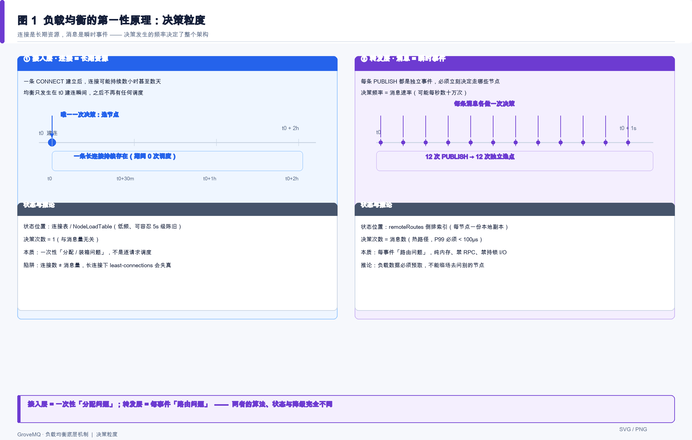
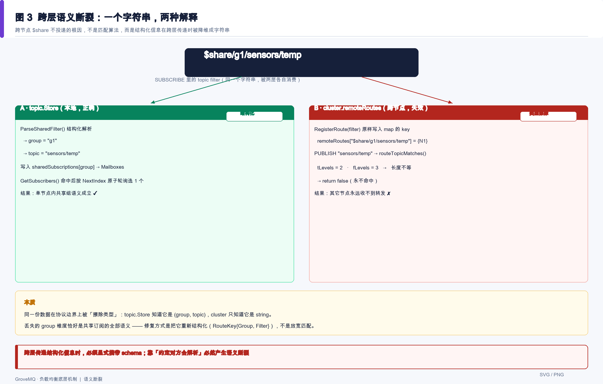
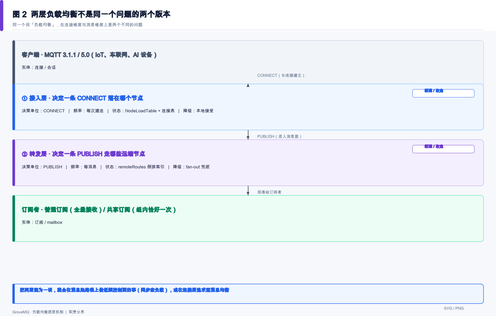
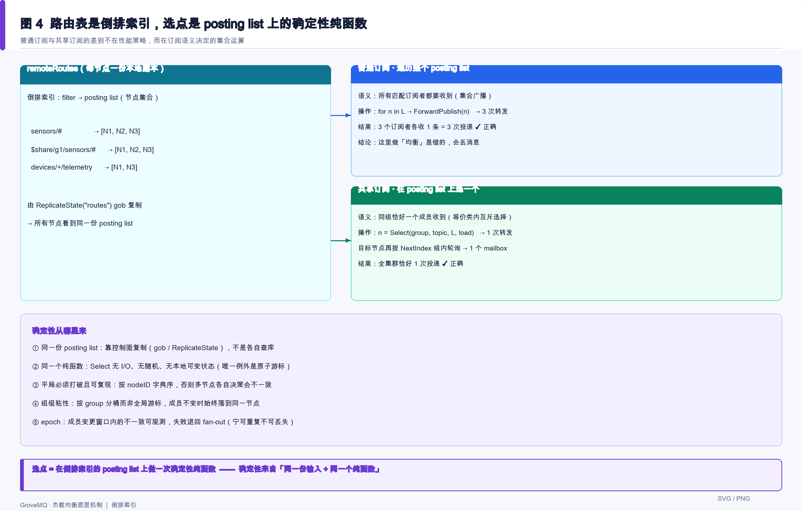
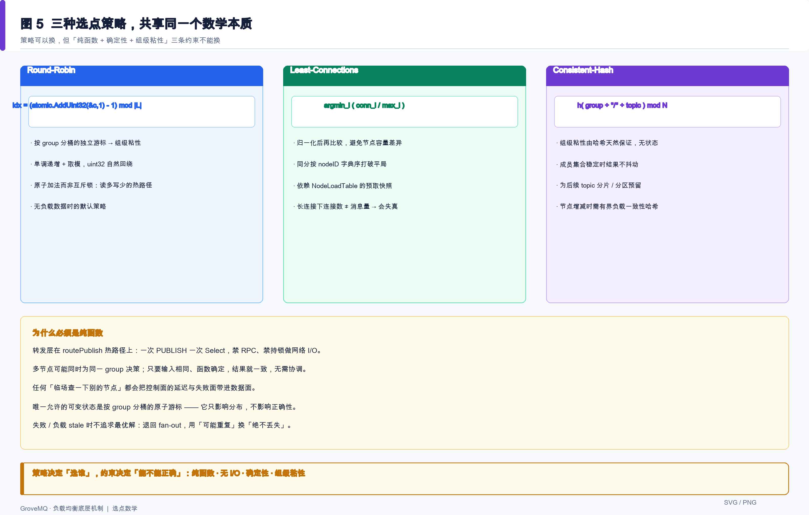
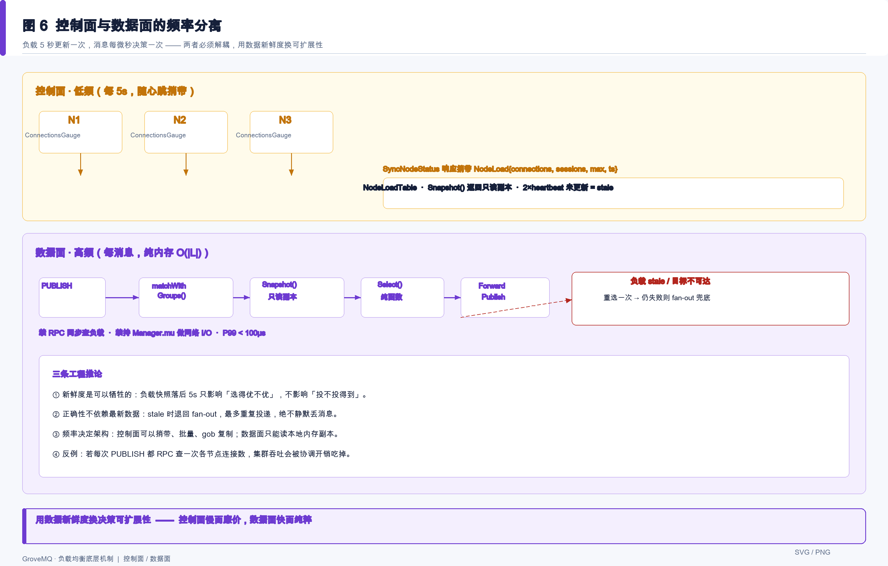

# 负载均衡的本质：从一条 MQTT 长连接，到一次跨节点选点

> 本文围绕 GroveMQ 的「接入层 + 转发层负载均衡」设计，往下挖一层，讲**决策粒度、语义驱动拓扑、确定性纯函数、控制面/数据面分离**这几件最底层的东西。
> 不谈功能清单，只谈**为什么必须这样做，以及不这样做会在哪里塌掉**。
> 配图 6 张（SVG 矢量 + PNG 预览），对应文中「图 1 ~ 图 6」。

---

## 引子：一个被用滥的词

「负载均衡」这四个字，在后端工程师的直觉里几乎等价于「把请求分摊到多台机器」。这个直觉来自 HTTP：每个请求短、无状态、彼此独立，调度器可以在每一次请求上重新决策。**一旦把它原封不动搬到 MQTT，几乎每一步都会错。**

MQTT 不是请求/响应模型，它是**长连接 + 发布订阅**模型。一条 TCP 连接建立之后可能存活数小时甚至数天，期间承载成千上万条 PUBLISH；而消息又不是「请求」，它不要求被某个服务实例处理，它要求**按订阅语义投递给一组订阅者**。于是「均衡」这个词在这里至少指两件完全不同的事：

- **接入层**：决定**一条连接**落在哪个节点；
- **转发层**：决定**一条消息**走哪些远端节点。

这两件事的**决策对象、决策频率、状态位置、失败降级全都不同**。把它们混为一谈，是最常见的架构错误：在消息热路径上做低频控制面的事（每次 PUBLISH 同步查一下各节点连接数），或者在连接层追求逐消息均衡（试图把一条已建立的连接「再均衡」出去）。



**图 1** 把差别画得很直白：接入层在 `t0` 建连瞬间做**唯一一次**决策，之后两小时内零调度；转发层在 1 秒内为 12 条 PUBLISH 做 12 次独立决策。

> **第一性原理：决策粒度决定架构。** 连接是长期资源，是一次性**分配 / 装箱问题**；消息是瞬时事件，是每事件**路由问题**。前者可以用慢而廉价的控制面数据，后者只能在本地内存里做纯函数。

---

## 一、长连接的数学：为什么 `least-connections` 会失真

先看接入层。假设一个 3 节点集群，节点容量都是 10 万连接。L4 负载均衡器在 `t0` 看到 N1 有 3 万连接、N2 有 1 万，于是把新连接给了 N2。这个决策**在连接建立后就被冻结了**。

接下来两小时可能发生的事是：N2 上这条连接是个车联网终端，每 50ms 上报一次遥测，每秒 20 条消息；而 N1 上那 3 万条连接全是「心跳保活、几乎不发消息」的传感器。此时**连接数最少的 N2，恰恰是消息负载最重的节点**。

这就是长连接场景下最本质的失配：

> **连接数是「存量」，消息量是「流量」。用存量去预测流量，只有在连接行为同质时才成立。**

HTTP 里这个问题不严重，因为一个请求就是一个工作单元，连接数≈并发请求数；MQTT 里一条连接是一个**容器**，容器里装多少消息与容器数量几乎无关。所以设计里才会出现几个看似「保守」的决定：

- **不做已有连接的在线迁移。** MQTT 协议没有标准的连接迁移动作，唯一合法的时点是客户端重连。任何试图在服务端把 session、inflight、will 状态搬到另一个节点的做法，都是在和协议较劲。
- **Mode A（L4 LB）是主路径，Mode B（MQTT 5 重定向）只是修正。** L4 只在建连瞬间分流，配合 `sessionAffinity: ClientIP` 让重连尽量落回原节点，这就是全部。
- **必须配 `MaxConnections` 准入上限。** 既然预测不准，就要给每个节点一个硬边界，避免热点无限堆积。
- **Mode B 的判定放在认证之后。** 否则一个无效凭据的连接也能触发跨节点重定向，等于把攻击面放大到整个集群。

顺带说一个协议层面的冷事实：**MQTT 3.1.1 根本不存在 `0x9C`（Use another server）这个 CONNACK 原因码**，它是 MQTT 5.0 才引入的。`connackReturnCode()` 对未知 v5 码在 3.1.1 上一律折叠成 `0x05`，如果强行给 3.1.1 客户端发重定向，客户端只会看到一个「未授权」然后断开。

> **协议版本就是能力边界。** 设计里对 3.1.1 客户端的处理是「跳过 Mode B、本地接受」，不是妥协，是唯一正确的行为。

还有一点容易被忽略：**为什么是「重定向」而不是「代理」？** MQTT 是二进制帧协议，L7 代理需要完整理解 CONNECT/PUBLISH/SUBSCRIBE 的帧边界、QoS 状态机、主题别名、属性长度，还要维护两套会话状态；而且代理本身会成为新的单点。相比之下 `CONNACK 0x9C + Server Reference` 只是告诉客户端「去连那台」，把连接建立的动作交还给客户端，服务端不持有任何中间状态。**重定向是无状态的，代理是有状态的** —— 在长连接场景里，这两者的运维成本差一个数量级。

而重定向天然带来环路风险：客户端不遵守 `Server Reference`，或者两个节点都认为对方更闲，就会来回弹跳。设计里的三件套 —— **单跳 + HMAC redirect_token + cooldown** —— 本质上是给「重定向」这个动作加上**已访问标记与冷却窗口**，把一个可能发散的图遍历收敛成一条至多一跳的边。

---

## 二、转发层：不是性能策略，是订阅语义决定的拓扑

现在看转发层。这里最容易犯的错，是以为「转发层负载均衡 = 从匹配节点里挑一个发过去」。**这在 MQTT 里是错的，而且错得很彻底。**

先把订阅用集合写出来。对主题 `t`，令：

```
S(t) = { sub | match(sub.filter, t) }
```

MQTT 对**普通订阅**的要求是：`S(t)` 中**每一个**订阅者都要收到这条消息。这是一个**集合广播**，路由拓扑必须是 fan-out，转发次数 = `|{node(s) : ∃sub ∈ S(t)}|`。在这里做「均衡」、只挑一个节点，等于直接丢消息。

而对**共享订阅** `$share/<group>/<topic>`，MQTT 5.0 的语义是：把 `S(t)` 按 `group` 划分成**等价类**，**每个等价类恰好一个成员**收到消息。这是一个**互斥选择**，且选择范围被限制在组内。

> **第二性原理：订阅语义决定路由拓扑，负载均衡只是共享订阅语义的实现手段。** 普通订阅的 fan-out 不是「没做优化」，而是语义本身要求的结果。谁把它优化掉，谁就在丢消息。

所以设计里 `RouteRemote` 被拆成两条路径：

- `group == ""`（普通订阅）→ 保持 fan-out，**行为与基线完全一致**，一个字节都不改；
- `group != ""`（共享订阅）→ 整组只选**一个**目标节点，携带 `SharedGroup` 转发。

**图 4** 展示了这个分叉。这里有个很漂亮的巧合值得单独讲：`ForwardPublish` 的 handler 本来就会调用 `LocalPublishFunc → RouteToLocalSubscribersWithQoS → GetSubscribers()`，而 `GetSubscribers()` 内部对共享订阅**已经**用 `NextIndex` 原子游标选出了一个成员。也就是说：

> **只要发布节点为共享组只选一个节点，目标节点内部的既有轮询机制会自动完成「组内选一个」，全集群恰好一次投递就自然成立，投递端一行都不用改。**

这是整个设计里最省力的一处：**新的全局决策复用了旧的局部机制**。复杂度没有增加，只是把「N 个节点各自选一个」收敛成「1 个节点选一个」。

反过来看基线为什么是坏的：即使路由 filter 修好了，一个跨 3 节点的共享组在 fan-out 下会收到 3 份转发，每个节点各选 1 个成员 → **3 次投递**。这不是性能问题，是**违反 MQTT 语义的正确性缺陷**。

---

## 三、最本质的 bug：一个字符串，两种解释

现在讲这次核查里最有价值的一个发现 —— 跨节点 `$share` 完全不通。它的根因不在匹配算法，而在**跨层传递时的类型擦除**。

看同一个字符串 `$share/g1/sensors/temp` 在两层的命运：

| | `topic.Store`（本地） | `cluster.remoteRoutes`（跨节点） |
| --- | --- | --- |
| 处理方式 | `ParseSharedFilter()` **结构化解析** | `RegisterRoute(filter)` **原样当 map key** |
| 得到的表示 | `(group="g1", topic="sensors/temp")` | `"$share/g1/sensors/temp"`（纯 string） |
| 后续 | 存入 `sharedSubscriptions[group]`，命中后按 `NextIndex` 轮询选 1 个 | `remoteRoutes[filter] = {N1}` |
| 结果 | ✔ 单节点内语义成立 | ✘ `routeTopicMatches("sensors/temp", "$share/g1/sensors/temp")` → `tLevels=2, fLevels=3` → **false** |



`routeTopicMatches` 本身没有错，它只是一个通用的层级匹配函数：先比长度，再逐段比较 `+` / `#`。它看到 `fLevels = ["$share", "g1", "sensors", "temp"]`（4 段，或按设计文档里 3 段的例子）与 `tLevels = ["sensors", "temp"]`（2 段），判 `false` 是完全正确的行为。**错的是把不该由它处理的数据交给了它。**

> **本质：结构化信息在协议边界上被降维成字符串，语义随之丢失。** `topic.Store` 知道这个 filter 是 `(group, topic)` 二元组，`cluster` 只知道它是一个 string —— 而丢失的那个 `group` 维度，恰好是共享订阅的**全部语义**。

这类 bug 在分布式系统里有通用名字：**跨层类型擦除（type erasure across boundaries）**。典型形态是：模块 A 把结构化对象序列化成字符串传给模块 B，两边各有一套「约定」该怎么解释，但约定不在类型系统里、不在 schema 里、也不在测试里，只存在于写代码的人脑子里。一旦有一方按「原样透传」实现，语义就断了。

所以修复方式**不是放宽匹配**（比如让 `routeTopicMatches` 认识 `$share` 前缀）—— 那只会把语义泄漏到通用匹配函数里，制造第二处隐式约定。正确的做法是把类型**重新结构化**：

```go
type RouteKey struct {
    Group  string // 空 = 普通订阅
    Filter string // 剥离 $share/<group>/ 后的真实 filter
}
```

路由表从 `map[string]map[string]struct{}` 改成 `map[RouteKey]...`，并在 SUBSCRIBE 时显式调用 `ParseSharedFilter()`；非法形式（段数不足、空 group）直接以 SUBACK `0x9F` 拒绝，而不是留到运行期静默失配。

> **设计准则：跨层传递结构化信息，必须显式携带 schema；靠「约定对方会解析」必然产生语义断裂。** 这条准则的价值远大于修掉这一个 bug。



**图 2** 是这次分层的全景：两层的状态位置、决策频率、降级策略完全不同，唯一的共同点是「都叫负载均衡」。

---

## 四、路由表是倒排索引，选点是 posting list 上的纯函数

把 `remoteRoutes` 换一个视角看，它就非常好理解了：这是一个**倒排索引**。

```
filter                       →  posting list（拥有匹配订阅者的节点集合）
sensors/#                    →  [N1, N2, N3]
$share/g1/sensors/#          →  [N1, N2, N3]
devices/+/telemetry          →  [N1, N3]
```

信息检索里倒排索引解决的是「给定词项，找出包含它的文档」；这里解决的是「给定主题，找出有订阅者的节点」。PUBLISH 就是一次查询，`MatchRemoteSubscribers()` 就是**取 posting list 并做 topic-filter 匹配**。

于是：

- 普通订阅 = **遍历整个 posting list**（fan-out）；
- 共享订阅 = **在 posting list 上做一次确定性纯函数选择**。



这个视角立刻推导出几条硬约束，比任何「最佳实践」都更有说服力：

**① 所有节点必须看到同一份 posting list。** 索引不是查出来的，是复制过来的：leader 通过 `ReplicateState("routes")` 用 gob 把整张表序列化后推给所有节点，每个节点持一份本地副本。如果各节点各自查库、各自维护视图，选点结果就没有共同输入，一致性无从谈起。

**② 选点必须是纯函数。** `Select(group, topic, candidates, load)` 不能查 RPC、不能读时钟、不能用随机数、不能依赖本地可变状态。原因是**多节点可能同时为同一个 group 决策**：只要输入相同、函数确定，结果就一致，不需要任何协调协议。反过来说，任何「临场查一下别的节点现在多少连接」都会把控制面的延迟和失败面直接灌进数据面。

**③ 平局必须打破，且必须可复现。** `argmin` 遇到两个节点负载相同时，如果按 map 遍历顺序挑，Go 的 map 迭代是随机的 → 不同节点选出不同目标 → 共享组被投递两次。**按 nodeID 字典序打破平局**不是审美，是正确性要求。

**④ 组级粘性，而非全局游标。** Round-Robin 必须按 `group` 分桶各自维护游标，而不是全集群共用一个计数器。否则同一个 group 的连续消息会被分散到不同节点，QoS inflight、会话状态、顺序性都会漂移。**粘性是共享订阅隐含的顺序性要求。**

**⑤ 索引变更要有 epoch。** 成员上下线会改 posting list；在变更窗口里，不同节点可能持有不同版本的索引。`selector_epoch` 不参与投递决策，只用于诊断「这次重复/漏投是不是撞上了成员变更」。

> **第三性原理：分布式下的「恰好一次」无法被保证，只能被逼近。** 工程上的取舍是**宁可重复、不可丢失**：选点失败、目标不可达、负载全 stale，一律退回 fan-out。重复投递至少能被业务侧幂等处理，静默丢消息则连排查线索都没有。

这里必须诚实地标出一个既有张力：`PublishForward` 当前不携带 `MessageId` / `Retain` / `Dup` / `UserProperties`，跨节点转发本来就是 **at-most-once**。也就是说「fan-out 兜底 = at-least-once」这个承诺，只在**投递路径**上成立，跨节点链路本身仍是可能丢的。这次设计**不扩大、也不顺手修**这个缺陷，而是把它登记为独立工单 —— 因为把可靠性语义和负载均衡语义混在一个改动里，是范围失控的经典起点。

---

## 五、原子游标：为什么是 `atomic.AddUint32` 而不是锁

共享订阅的组内选择，实现只有一行：

```go
idx := atomic.AddUint32(&sharedSub.NextIndex, 1) - 1
selected := sharedSub.Mailboxes[int(idx%uint32(len(sharedSub.Mailboxes)))]
```

为什么这样写？因为 `GetSubscribers()` 的调用方持有的是 `Store.mu.RLock()` —— **读锁**。原实现却在这把读锁下对 `NextIndex` 做普通赋值写，于是并发发布者之间产生真实的数据竞争（`-race` 能稳定复现：`store.go:231` 读 / `store.go:235` 写）。

三个候选方案：

| 方案 | 问题 |
| --- | --- |
| 把 `RLock` 升级成 `Lock` | 所有订阅读取串行化，topic 热路径从「读多」变成「全互斥」，吞吐塌方 |
| 单独给 `NextIndex` 加一把 mutex | 每次选点两次锁操作，且引入新的锁顺序约束 |
| **原子递增 + 取模** | 单条 CPU 指令、无锁、读路径不变 ✔ |

关键点在于**把「选第几个」从「读-改-写共享变量」改写成「单调递增计数 + 无状态取模」**。取模的结果只依赖当前计数与切片长度，不依赖任何其它状态；`uint32` 自然回绕也不会破坏正确性（`2^32` 是偶数，对常见长度取模的均匀性影响可忽略，且不越界）。

> **本质：消除竞争的最好方式不是加锁保护共享状态，而是把共享状态变成「单调递增 + 纯函数派生」。** 写仍然发生，但发生在原子变量上；所有派生逻辑都是无状态的。

同样的思路也用在转发层选点：Round-Robin 游标按 group 分桶做原子递增，策略本身仍是纯函数。



**图 5** 把三种策略并列：Round-Robin 的模运算、Least-Connections 的归一化 `argmin`、Consistent-Hash 的键构造。公式不同，但**纯函数 / 无 I/O / 确定性 / 组级粘性**四条约束完全相同 —— 策略决定「选谁」，约束决定「能不能正确」。

---

## 六、控制面与数据面：用新鲜度换可扩展性

负载数据从哪来？核查里有个重要更正：`pkg/clustermon` 里那套 `LoadBalanceRatio`、`ConnectionsPerNode` 看着很完备，但 `NewClusterMonitor` 在全仓库**零调用**，`collectMetrics()` 也只填本地节点 —— **整个负载监控是死代码**。所以设计不能依赖它，必须自己建一条轻量通道。

但通道怎么建，是由频率决定的：

- **控制面（低频）**：节点负载 5 秒变化一次就够用，完全可以搭在既有 `SyncNodeStatus` 心跳的响应里捎带一个 `NodeLoad{connections, sessions, max, ts}`，**不新增 RPC、不新增连接**。
- **数据面（高频）**：每条 PUBLISH 都要选点，可能每秒数十万次。这里**只能读本地内存副本**，任何网络调用都是灾难。

于是 `NodeLoadTable` 的职责被压到极简：`Update()` 写入心跳数据、`Snapshot()` 返回**只读副本**、`IsStale()` 判断是否超过 `2 × heartbeat`。选点拿到的永远是快照，不是实时查询。



这个设计里最值得记住的一句话是：

> **负载数据落后 5 秒，只影响「选得优不优」，不影响「投不投得到」。**

因为正确性根本不依赖最新数据：一旦快照 stale、或选中的节点不可达，降级路径是**退回 fan-out**，最多产生重复投递，绝不静默丢消息。**新鲜度是可以牺牲的，正确性不能。** 反过来，如果每次 PUBLISH 都同步 RPC 查一遍各节点连接数，集群吞吐会被协调开销直接吃掉，而且任何一次网络抖动都会变成消息投递失败 —— 把控制面的失败面引进了数据面。

由此还能推出一条通用判据：**看一个决策能不能放在热路径上，就问「它的数据多久变一次」。** 变化频率远低于决策频率的数据，就应该预取、缓存、捎带；只有与决策同频的数据才值得临场获取。

---

## 七、Schema 演化：滚动升级里没有「同一时刻」

最后一个底层机制，是关于**混合版本共存**。

改路由表结构（`map[string]...` → `map[RouteKey]...`）会连带改变 `ReplicateState("routes")` 里 gob 编码的内容。集群滚动升级时，旧节点还在发 v1 格式，新节点已经只认 v2 —— 一次升级就能让路由表解码失败、跨节点投递全停。

> **分布式系统里不存在「所有节点同时更新」这个时刻。** 任何持久化/复制格式的变更，都必须假设新旧格式会在集群里共存一段时间。

设计里的处理是三件套：

1. **state key 升版本**：新格式写 `routes:v2`，`ApplyStateEntries` 同时识别 `routes`（旧）与 `routes:v2`，旧格式**只读转换成 v2**，不试图反向写回；
2. **feature flag 默认关闭**：`GROVEMQ_SHARED_ROUTE_POLICY=fanout` 时新节点完全走旧路径，行为与基线逐字节一致，混跑零风险；
3. **开关与格式解耦**：只有显式切到 `single` 才写 v2，灰度粒度可控，回滚只需把开关拨回去。

顺带一个容易踩的坑：仓库里有**两份** `cluster.proto`，`pkg/proto/cluster/cluster.proto` 才是生成源（`cluster.pb.go` 的 header 明确写着 `source: pkg/proto/cluster/cluster.proto`），另一份 `proto/cluster/cluster.proto` 是 schema 更旧的残留副本。**只改后者会静默失效** —— 这又是「跨层/跨副本类型擦除」的一个变体：连「哪份是真相」都没有被类型系统固定下来。

---

## 八、收束：四条本质，映射到实现

把上面所有讨论压缩成四条，它们分别对应设计里的具体改动：

| 本质 | 一句话 | 对应实现 |
| --- | --- | --- |
| **决策粒度** | 连接是一次性分配，消息是每事件路由 | 接入层低频控制面 / 转发层热路径纯内存 |
| **语义驱动拓扑** | fan-out 不是没优化，是普通订阅的语义；互斥选择是共享订阅的语义 | `RouteRemote` 按 `group` 双路径分流 |
| **显式 schema** | 结构化信息跨层不能降维成字符串 | `RouteKey{Group, Filter}` + `ParseSharedFilter` |
| **确定性 + 降级** | 同一份输入 + 纯函数 = 一致；失败宁可重复不可丢失 | `ReplicateState` 复制索引、字典序破平局、fan-out 兜底 |

以及两条贯穿始终的工程约束：**控制面与数据面按频率分离**、**格式变更必须容忍混合版本共存**。

最后回到那个被用滥的词。负载均衡从来不是「把流量摊平」这么一个动作，它是**「在什么粒度上、依据什么语义、用多新的数据、由谁来做一次确定性决策」**这一整组问题的答案。在 GroveMQ 里，接入层的答案是「建连时、按连接数、用 5 秒前的快照、由 LB 或 CONNACK 做一次分配」；转发层的答案是「每条消息、按订阅语义、用本地索引副本、由纯函数做一次选点」。

**把这两组答案分开写清楚，比实现任何一个策略都重要。**

---

## 附：图索引

| 图 | 主题 | 文件 |
| --- | --- | --- |
| 图 1 | 决策粒度：一次性分配 vs 每事件路由 | `images/fig1-decision-granularity.svg` |
| 图 2 | 两层职责分界与状态位置 | `images/fig2-two-layers.svg` |
| 图 3 | 跨层语义断裂（类型擦除） | `images/fig3-semantic-fracture.svg` |
| 图 4 | 倒排索引与 fan-out / 单选 | `images/fig4-inverted-index.svg` |
| 图 5 | 三种选点策略的数学本质 | `images/fig5-selector-math.svg` |
| 图 6 | 控制面 / 数据面频率分离 | `images/fig6-control-data-plane.svg` |

> 本文基于 `52d0abf` 代码实读撰写，设计细节见 `docs/design/LOAD_BALANCING.md`。文中标注的基线缺陷（跨节点 `$share` 不通、`PublishForward` 缺字段、`ApplyStateEntries` union-only 合并）均为实读结论，未在本设计中顺手修改。
